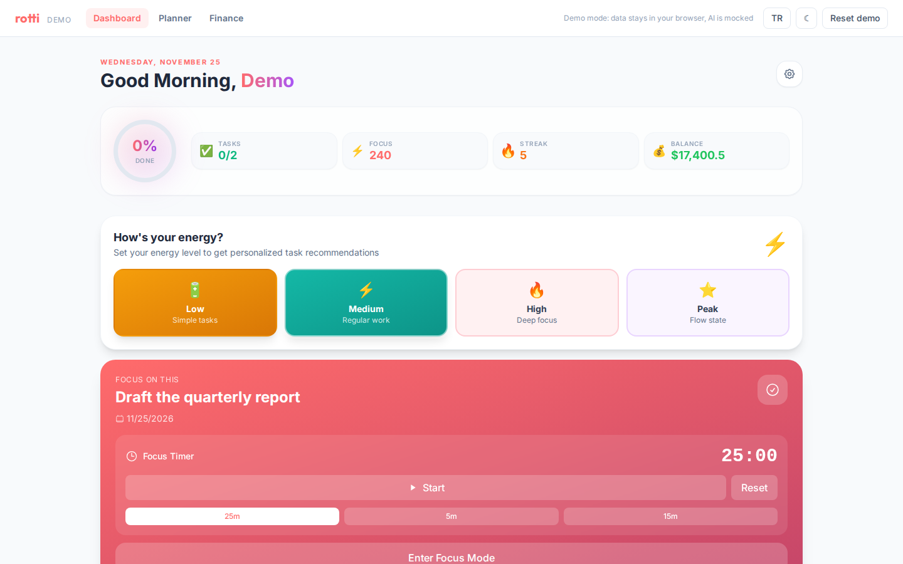
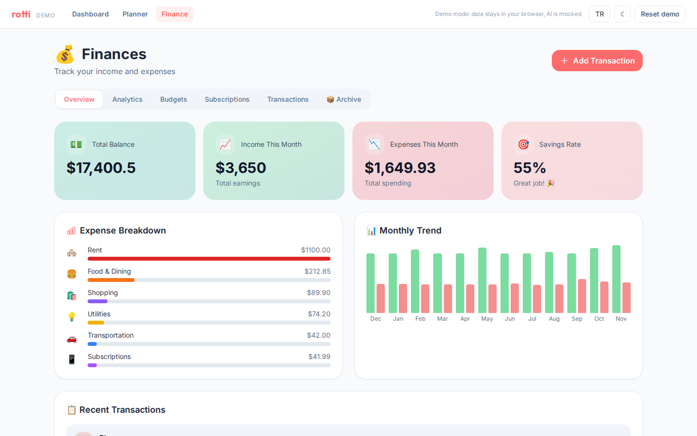

# Rotti: Dashboard, Planlayıcı ve Finans

Rotti, planlama, hedefler, finans, sağlık, yemek ve rutinleri tek ekranda toplayan, yapay zekâ destekli bir yaşam yönetimi uygulamasıdır. Bu depo, uygulamanın **Dashboard, Planlayıcı ve Finans** modüllerini tek başına çalışan bir demo olarak sunar.

**Tam uygulama:** https://rotti.life · Tam uygulamanın kaynak kodu özel (private) bir depoda tutulur.



## Bu demoda neler var?

### Dashboard

- Günlük ilerleme halkası, odak puanı, seri ve toplam bakiye özeti
- Enerji seçici ve seçilen enerjiye göre "şimdi bunu yap" odak görevi, odak zamanlayıcısı (Pomodoro tarzı)
- Görevler, yaklaşanlar, acil işler, mini takvim, alışkanlık ısı haritası, üretkenlik skoru, günlük inceleme ve finans mini grafiği widget'ları
- Widget'ları sürükleyip yeniden sıralama, gösterme/gizleme ve boyut ayarları

### Planlayıcı

- **Bugün:** saat saat zaman çizelgesi, enerji seviyesine göre "sıradaki en iyi görev" önerisi
- **Hafta, Ay:** haftalık ve aylık takvim görünümleri
- **Tüm görevler:** sıralanabilir liste
- **Pano (Kanban):** Yapılacak / Devam ediyor / Bitti sütunları, sürükle-bırak ile taşıma
- Tek yapıda üç öğe türü (görev, alışkanlık, etkinlik), alt görevler, etiketler, projeler, tekrar kuralları, hızlı ekleme çubuğu ve ayrıntılı ekleme paneli

### Finans

- Genel bakış, analiz, bütçeler, abonelikler ve işlem listesi sekmeleri
- Gelir/gider ekleme, kategori bazlı harcama dağılımı, 12 aylık gelir-gider trendi
- Kategori bazlı aylık bütçeler ve abonelik takibi

Ayrıca açık ve koyu tema, TR/EN dil düğmesi ve tüm verileri sıfırlayan "Demoyu sıfırla" düğmesi vardır.

| Planlayıcı                                          | Finans                                  |
| --------------------------------------------------- | --------------------------------------- |
|  |  |

## Demo nasıl çalışır?

Hesap, arka uç veya yapay zekâ hizmeti gerektirmeden doğrudan açılır:

- Giriş (auth) yoktur, tek bir sahte demo kullanıcı vardır.
- Tüm veriler (görevler, işlemler, bütçeler, abonelikler) **uydurma örneklerdir** ve yalnızca tarayıcının `localStorage` alanında tutulur.
- Veritabanı, gerçek zamanlı senkronizasyon ve API anahtarı yoktur. Uygulama yalnızca yazı tipleri için Google Fonts'a istek yapar.
- Yapay zekâ çağrıları sabit/kural tabanlı **mock** cevaplarla değiştirilmiştir (aşağıya bakın).

## Kullanılan teknolojiler

| Katman         | Teknoloji                               |
| -------------- | --------------------------------------- |
| Arayüz         | React 19, TypeScript, Vite 6            |
| Stil           | Tailwind CSS 3                          |
| Durum yönetimi | Zustand                                 |
| Animasyon      | Framer Motion                           |
| Sürükle-bırak  | dnd-kit (Dashboard widget sıralama)     |
| Grafikler      | Recharts                                |
| Bildirimler    | react-hot-toast                         |
| Veri           | `localStorage` üzerinde yerel mock depo |

## Kurulum

Gereksinimler: Node.js 20.19+ (veya 22.12+)

```bash
npm install
npm run dev
```

Uygulama http://localhost:3000 adresinde açılır. Üretim derlemesi için `npm run build` (önce tip denetimi, sonra Vite derlemesi çalışır).

## Yapay zekâ kullanımı

**Üründe:** Tam uygulamada Google Gemini ile doğal dilden görev çıkarma, görevi alt adımlara bölme ve otomatik zamanlama gibi özellikler kullanılır. İstekler sunucu üzerinden geçer, API anahtarları tarayıcıya verilmez.

**Bu demoda:** Gemini yoktur, hiçbir ağ isteği yapılmaz. `src/mocks/aiMock.ts` ve `src/hooks/useAIScheduler.ts` içindeki mock'lar:

- Hızlı ekleme: "yarın", "bugün", "acil" gibi birkaç anahtar kelimeyi tanıyan basit kurallar
- Görevi alt adımlara bölme: her zaman aynı üç örnek alt görev
- Otomatik zamanlama ("Magic Schedule"): görevleri sıradaki boş saatlere yerleştirir

**Geliştirmede:** Claude Code (Anthropic) ile kod yazma, yeniden düzenleme ve test üretimi; proje içinde rol bazlı Claude Code ajanları kullanıldı. Bu demonun hazırlanması (mock katmanı, örnek veri, ekran görüntüleri) de Claude Code ile yapıldı. Üretilen kod elle gözden geçirildi; tam projede birim ve uçtan uca testlerle doğrulanır.

## Proje yapısı

```
src/
  components/   Dashboard, Planlayıcı (Bugün, Hafta, Ay, Pano) ve Finans görünümleri
  hooks/        Mock veri hook'ları (localStorage tabanlı)
  mocks/        Yerel depo, örnek veriler (seed) ve yapay zekâ mock'ları
  store/        Zustand store'ları
  locales/      Arayüz metinleri (EN, TR)
```

## İletişim

Efe Kırmızı · [GitHub](https://github.com/efekirmizisocials-hash)
